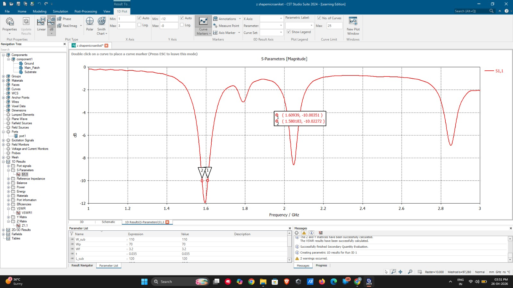
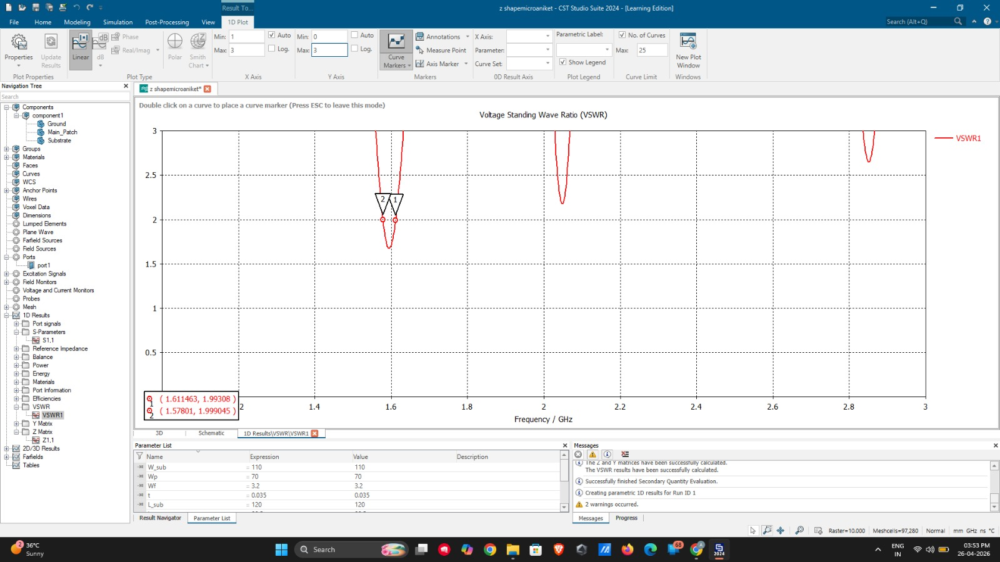
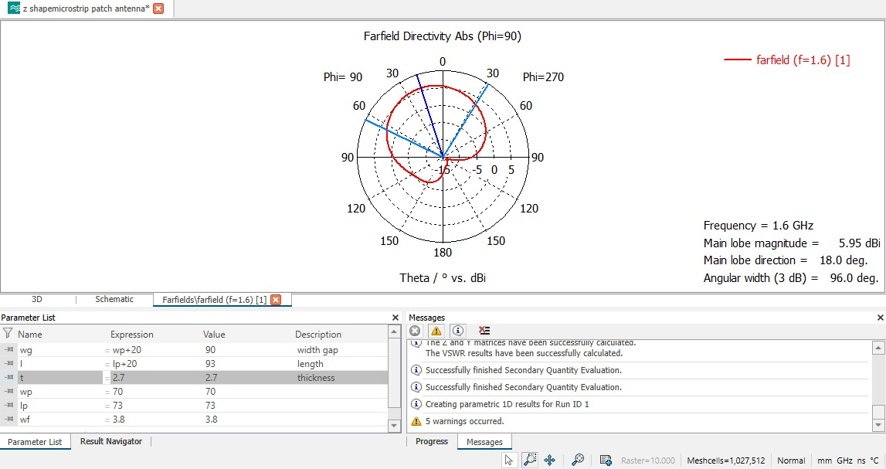

# Z-Shaped Microstrip Patch Antenna Design

## Project Overview
Design and simulation of a Z-shaped microstrip patch antenna designed for a target operating frequency of 1.6 GHz using CST Studio Suite.

## Tools & Technologies
- CST Studio Suite 2024
- Electromagnetic Simulation
- Microstrip Patch Antenna Design
- S-Parameter Analysis
- Far-field Radiation Analysis

## Design and Simulation Results## Design and Simulation Results

### 1. 3D Antenna Design

### 2. Antenna Schematic

### 3. S11 / Return Loss

### 4. S11 Impedance View

### 5. VSWR

### 6. Far-field Radiation Pattern

### 1. 3D Antenna Design
File: `antenna 3d design.jpeg`

### 2. Antenna Schematic
File: `antenna schematic.jpeg`

### 3. S11 / Return Loss
File: `s11.jpeg`

### 4. S11 Impedance View
File: `s11 impedence veiw.jpeg`

### 5. VSWR
File: `vswr.jpeg`

### 6. Far-field Radiation Pattern
File: `farfeild.jpeg`

## Project Files
- Antenna design screenshots
- S11 and impedance plots
- VSWR simulation results
- Far-field radiation results

## Author
**Aniket Aher**

B.Tech – Electronics and Telecommunication Engineering
